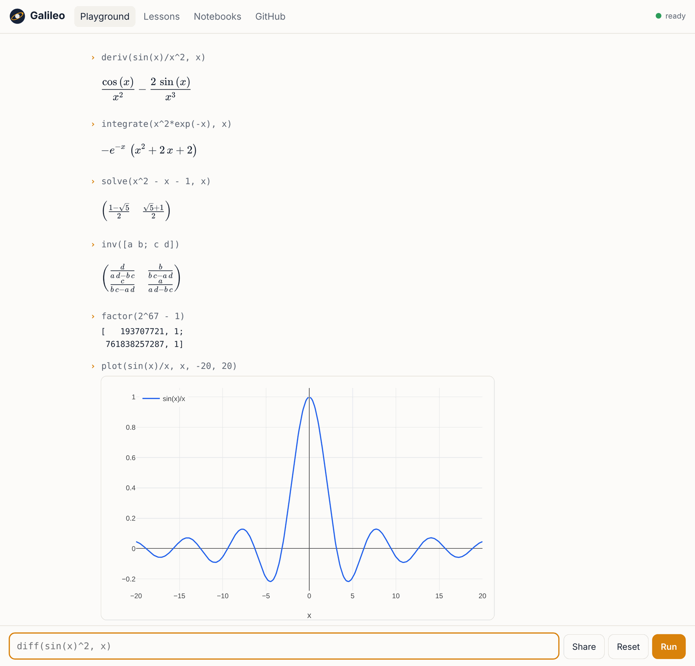
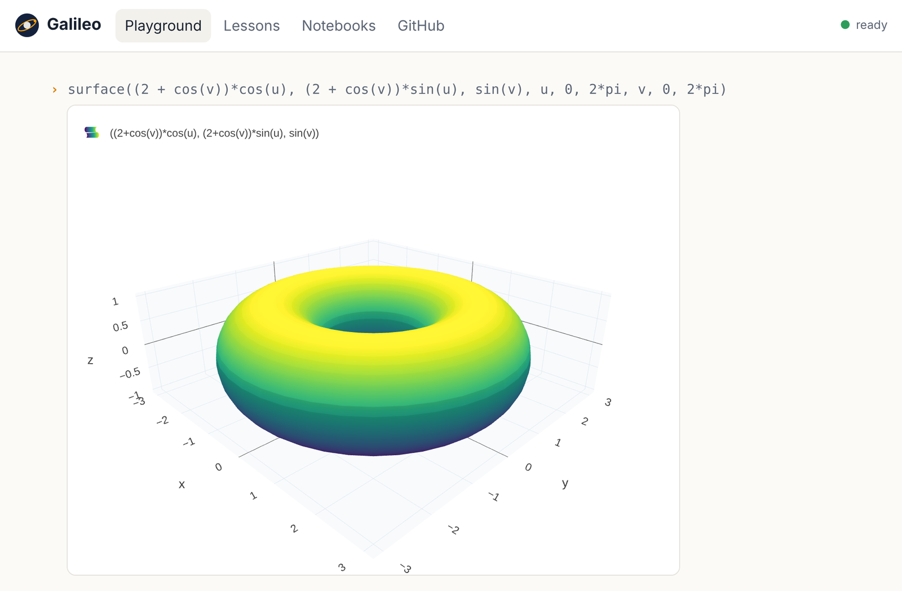
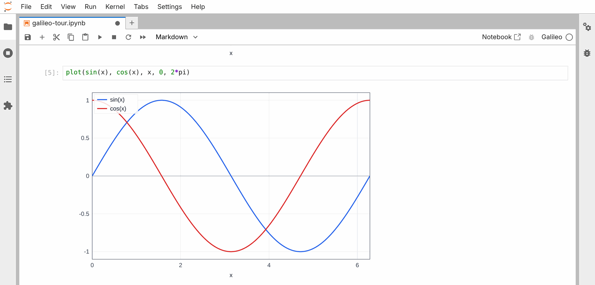

# Galileo

Galileo is a free computer algebra system, written in Rust.

**▶ [Try Galileo in your browser](https://cascala.github.io/igalileo/)**: nothing to install. Open the [playground](https://cascala.github.io/igalileo/playground/), start the [first lesson](https://cascala.github.io/igalileo/playground/#lesson/foundations/01-numbers), or use [notebooks in JupyterLite](https://cascala.github.io/igalileo/lab/lab/index.html).

**Questions, ideas or something you made with Galileo?** Join the [Discussions](https://github.com/cascala/galileo/discussions).



Galileo reads much like MATLAB (`deriv(x^3, x)`, `[a b; c d]`, `[L, U, P] = lu(A)`, ...),
but everything is symbolic and exact unless you ask for numbers. The engine is built on a few ideas:

* **Exact numbers.** Integers and fractions are exact rationals: `1/3 + 2/6` is `2/3`,
  `sqrt(8)` is `2*sqrt(2)`, and they have no size limit: `2^521 - 1` keeps all 157 digits
  (small numbers use i128, larger ones switch to big integers automatically and never turn
  into floats). Decimals like `0.5` are floats, and floats are contagious.
* **Canonical forms.** Every expression is built through smart constructors that flatten
  sums and products, fold numbers, collect like terms and powers, and sort operands. So
  `8*y*u*y*u*y^5*y*u*u^6*r*y*7*y` is simply `56*r*u^9*y^10`, with no hand-written
  pattern rules.
* **Small core.** Subtraction is `a + (-1)*b`, division is `a * b^-1`, `exp(x)` is `e^x`.
  The printer turns these back into `-`, `/` and `exp`, and its output can be pasted back in.
* **Values, not statements.** The parser produces a syntax tree; functions are looked up by
  name at evaluation time, so `sinx` is just a variable and adding a function is one match arm.
  Unknown names are errors, except one-letter names like `a(t)` or `f2(x)`, which are
  undefined functions: `deriv(a(t)^2, t)` is `2*a(t)*a'(t)`.
* **Rational-function simplification.** `simplify` puts expressions over a common
  denominator, cancels polynomial factors exactly, and rewrites `sin^2` as `1-cos^2` where
  that helps. Curvature results come out tidy (the Kerr Ricci tensor is zero in about 2 s).
* **Late binding.** A variable holds an expression, and names in it are looked up again when
  it is used: after `f = a*x; a = 2`, `f` is `2*x`.

## Try it

```
cargo run --bin galileo               # interactive prompt
cargo run --bin galileo file.gg       # run a file
cargo run --bin galileo -- -i file.gg # run a file, then keep the prompt open
```

```
galileo> deriv(sin(x)/x^2, x)
cos(x)/x^2-2*sin(x)/x^3
galileo> simplify(ans)
(x*cos(x)-2*sin(x))/x^3
galileo> A = [a b; c d]; inv(A)
d/(a*d-b*c)	-b/(a*d-b*c)
-c/(a*d-b*c)	a/(a*d-b*c)
galileo> simplify(cos(y)^2 + sin(y)^2)
1
```

Or with Docker, on Intel or Apple Silicon:

```
docker run -it --rm cascala/galileo                          # interactive prompt
docker run --rm -v "$PWD:/work" cascala/galileo file.gg      # run a file
docker run -it --rm -v "$PWD:/work" cascala/galileo -i file.gg  # run it, then the prompt
```

The container sees only the folders you mount: `-v "$PWD:/work"` makes your current
folder its working folder, so `file.gg` and `load(file.gg)` at the prompt find your files.

The `-it` matters for the prompt: without it Docker gives Galileo no terminal, so the
arrow keys and backspace cannot work. At the prompt, left and right move through the
line, up and down step through earlier input, Ctrl-R searches it, Ctrl-C drops the
current input and Ctrl-D (or `exit`) quits. History is kept in `~/.galileo_history`
(or the file named by `GALILEO_HISTORY`). To keep it between container runs, give it a
volume:

```
docker run -it --rm -v galileo-home:/home/galileo cascala/galileo
```

To publish the image for both architectures:

```
docker buildx build --platform linux/amd64,linux/arm64 -t cascala/galileo:0.5.0 -t cascala/galileo:latest --push .
```

Type `help` for the list of commands, and `help(name)` for one of them. A statement ending
in `;` runs without printing its result.

**Reference:** the [language reference](docs/language.md) describes how Galileo is written
(statements, numbers, operators, functions, matrices, strings, lists, records and blocks),
and the [command reference](docs/builtins.md) lists every command with an example.

## Scripts

A script is a text file of Galileo statements, one per line, usually named `*.gg`:

```
// orbit.gg
G = 1; M = 1;
v(r) = sqrt(G*M/r)
plot(v(r), \
     r, 0.5, 5)
```

* `galileo orbit.gg` runs it and prints each result; a statement ending in `;` stays quiet.
* `galileo -i orbit.gg` runs it and then opens the prompt, with everything it defined.
* `load(orbit)` runs it from the prompt or a notebook (`.gg` may be left off; quote names
  with spaces: `load("my orbit.gg")`). A script can load others; names are looked up in
  the current folder, then next to the loading script.
* An error stops the script and says where: `orbit.gg:4: unknown function plt`.
  `galileo file.gg` then exits with status 1.
* A statement can span lines: inside `( )` a new line is just space, inside `[ ]` it starts
  a new matrix row, and a line ending in `\` continues on the next one. The prompt waits
  for the rest (`...>`), and pasting a block of lines runs each statement in turn.

## Differential geometry

```
galileo> S = metric.generate(schwarzschild)
ds^2 = -(r-r_s)/r*dt^2 + r/(r-r_s)*dr^2 + r^2*dtheta^2 + r^2*sin(theta)^2*dphi^2
galileo> christoffel(S)[1,0,0]
r_s*(r-r_s)/(2*r^3)
galileo> kretschmann(S)
12*r_s^2/r^6
```

* `metric(coords, g)`, `metric.generate(name)` (minkowski, polar, euclidean, spherical,
  two-sphere, three-sphere, schwarzschild, torus, hyperbolic), `inducedmetric(embedding, coords)`
* `christoffel` (`christoffelfirst`, `christoffelsecond`), `riemann` (`riemannfirst`,
  `riemannsecond`), `riccitensor`, `ricciscalar`, `einsteintensor`, `einsteinscalar`,
  `schoutentensor`, `weyltensor`, `gausscurvature`, `kretschmann`, `geodesics`, `inverse`
* Components are indexed from 0: `g[0,0]`, `riemann(g)[1,0,1,0]`.
* `geodesic(g, x0, v0, s1)` integrates a geodesic and plots it.

## Multivariable calculus and special functions

* `grad`, `div`, `curl`, `laplacian` in Cartesian, polar, cylindrical and spherical
  coordinates; `jacobian`, `hessian`, `potential` (a scalar potential, or `[]`).
* `lineint` (work and arc length), `flux` and `surfint` over parametrized surfaces.
* `critical`, `classify` (second-derivative test), `minimize`/`maximize` (closed interval,
  critical points, or BFGS from a start), `lagrange` (one or more constraints).
* `solve` and `fsolve` handle systems: polynomial systems exactly (substitution, factoring,
  resultants; real solutions, and curves of solutions with a free unknown), others by Newton.
* `gamma`, `beta`, `digamma`, `polygamma`, `erf`, `erfc`, `erfi`, `zeta`, `besselj`,
  `bessely`, `besseli`, with exact values (`gamma(7/2)`, `zeta(4)`), derivatives and limits;
  `legendre`, `hermite`, `laguerre`, `chebyshev`, `chebyshevu` polynomials. Integrals of
  `p(x) e^(ax^2+bx+c)` come out with `erf`, and `x^p e^(-kx)` over `[0, inf)` with `gamma`.

## Plots and ODEs

<p>
  
  
</p>

`plot`, `parametric`, `plot3d`, `surface`, `parametric3d`, `contour`, `implicitplot`,
`fieldplot`, `odeplot`, `odesolve` and `geodesic`. In the terminal a plot is drawn in text; in a notebook it is an interactive
Plotly chart with an SVG fallback. `odesolve` uses fixed-step RK4.

## VS Code

[editors/vscode](editors/vscode) is a VS Code extension: syntax colors for `.gg` files, a
Run File button, and Shift+Enter to send the statement under the cursor to a Galileo prompt.
Build it with `npm install && npx vsce package` there and install the `.vsix`.

## Jupyter

`galileo --kernel` serves a simple line protocol on stdin/stdout (see `src/kernel.rs`):
a header line `execute <length>`, `complete <cursor> <length>` or `inspect <cursor> <length>`,
then the code; each reply is one line of JSON with MIME bundles (text, LaTeX, Markdown, SVG,
Plotly). [iGalileo](https://github.com/cascala/igalileo) wraps it in a small Python ipykernel.

## Galileo in a web page

To put live Galileo examples in your own web page (lesson notes, worksheets, a blog),
add one line to the page and write each example as a `<pre class="galileo">` block:

```html
<script src="https://cascala.github.io/igalileo/embed/galileo.js" defer></script>

<pre class="galileo" data-autorun>deriv(sin(x)^2, x)</pre>
```

Readers can edit and run every block, in their own browser. See
[Galileo in your own page](https://cascala.github.io/igalileo/embed/) for the options,
a template, and a download for use without internet.

## WebAssembly

The same engine runs in a browser. It has no dependencies and builds straight to WebAssembly
(about 800 KB, no imports):

```sh
rustup target add wasm32-unknown-unknown
cargo build --release --target wasm32-unknown-unknown --lib
# target/wasm32-unknown-unknown/release/galileo_rs.wasm
```

`src/wasm.rs` exports a small C ABI (`galileo_alloc`, `galileo_execute`, `galileo_complete`,
`galileo_inspect`, `galileo_reset`, `galileo_seed`) whose replies are the same JSON as the
`--kernel` protocol. iGalileo's JupyterLite site and the Galileo playground use it.

In the browser, files live in memory (`src/vfs.rs`): the page puts the user's files in with
`galileo_fs_put` (and `galileo_fs_mkdir`, `galileo_fs_cd`, `galileo_fs_unput`), and after
each run collects what Galileo wrote or removed with `galileo_fs_changes`. So `load`, `read`,
`save`, `ls`, `cd`, `pwd` and `rm` work there too, and a script with relative file names
runs the same in the terminal, in Jupyter, in JupyterLite and in the playground. The
playground keeps its files in the browser (IndexedDB); JupyterLite uses its own file
browser. `galileo_export` turns a plot into PNG or EPS.

## Programming

Loops, conditions and functions of several statements are blocks closed by `end`.
Statements inside show their results unless they end in `;`.

```
function r = collatz(n)
  r = 0;
  while n ~= 1
    if mod(n, 2) == 0
      n = n/2;
    else
      n = 3*n + 1;
    end
    r = r + 1;
  end
end

for n = 1:5
  print("collatz", n, "=", collatz(n))
end
```

The [language reference](docs/language.md) covers all of it: loops and conditions,
functions, strings, lists and records, assignment to parts, and elementwise operators.

## Changing the language

`tests/reference.rs` keeps the reference in step with the engine, and CI runs it:

* every example in `docs/language.md` is run, and must show what the reference says;
* `docs/language.md` carries a stamp of `src/parser.rs`: after any change to the parser,
  the test fails until the reference has been updated for it and the stamp renewed;
* `docs/builtins.md` is generated from the help entries in `src/help.rs`;
* every command the engine answers to must have a help entry, and every help example
  must run without an error.

After updating `docs/language.md` or `src/help.rs`, renew the stamp and the command reference with

```
GALILEO_BLESS=1 cargo test --test reference
```

## Layout

| File | What it does |
| --- | --- |
| `src/num.rs` | Exact rationals with float fallback |
| `src/expr.rs` | The expression tree and its canonical ordering |
| `src/build.rs` | Smart constructors (`add`, `mul`, `pow`, `func`) that keep expressions canonical |
| `src/print.rs` | Printer (fractions, signs, `sqrt`, `exp`) |
| `src/calc.rs` | `deriv`, `expand`, `factor`, `simplify`, substitution, numeric evaluation |
| `src/algfactor.rs`, `src/factor_cmd.rs` | Polynomial factoring over the integers (Zassenhaus), cyclotomic polynomials, Aurifeuillean factors, algebraic splitting of `a^n ± b^n`; `cyclotomic`, `algfactor`, `factorsearch` |
| `src/linalg.rs` | Matrices: product, inverse, determinant, LU, solve, norms |
| `src/decomp.rs` | Decompositions: Gram-Schmidt and QR, Cholesky, SVD, Jordan form, matrix exponential, Kronecker product |
| `src/la_cmd.rs` | Commands for the decompositions (`[Q, R] = qr(A)`, `svd`, `jordan`, `expm`, `chol`, `kron`, `diag`) |
| `src/parser.rs` | Lexer and Pratt parser |
| `src/eval.rs` | Sessions: variables, commands, built-in functions |
| `src/lang.rs` | Blocks (`for`, `while`, `if`, `function`), lists, records, strings, assignment to parts |
| `src/prec.rs` | `eval(x, digits)`: many-digit values in fixed point |
| `src/help.rs` | `help` and `help(name)`; the source of `docs/builtins.md` |
| `docs/language.md`, `docs/builtins.md` | The language reference and the command reference |
| `src/ratfun.rs` | Rational-function normal form behind `simplify` |
| `src/geometry.rs` | Metrics, curvature tensors, geodesic equations |
| `src/commands.rs` | Geometry, plot and ODE commands |
| `src/special.rs` | Special functions (gamma, erf, zeta, Bessel): exact values, numerics, derivatives; orthogonal polynomials |
| `src/vcalc.rs`, `src/mv_cmd.rs` | Vector calculus, polynomial systems, optimization, Lagrange multipliers, contour and field plots |
| `src/numeric.rs`, `src/ode.rs` | Compiled numeric evaluation and RK4 |
| `src/plot.rs` | Figures: text, SVG and Plotly JSON |
| `src/latex.rs`, `src/display.rs` | LaTeX and notebook MIME bundles |
| `src/kernel.rs` | `galileo --kernel` protocol |
| `src/wasm.rs` | WebAssembly entry points for the browser |

## Status

- [x] Core algebra, calculus, simplification, matrices, parser, REPL
- [x] Tensors and differential geometry (metrics, Christoffel, Riemann, Ricci, Einstein, Weyl, geodesics, ODE solver)
- [x] Plotting (SVG and Plotly) and LaTeX output
- [x] Jupyter kernel (through iGalileo)

## Citing Galileo

Galileo is created by Joris Esch ([cascala](https://github.com/cascala)). If you use it in teaching, research or writing, please cite it: GitHub's **Cite this repository** button (in the sidebar) gives APA and BibTeX, from [CITATION.cff](CITATION.cff).

## License

Apache 2.0.
